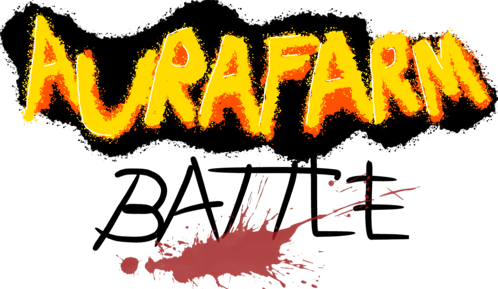

  <a href="http://localhost:4000">
    <picture>
      <source media="(prefers-color-scheme: dark)" srcset="./client/public/game-logo-white.png">
      <source media="(prefers-color-scheme: light)" srcset="./client/public/game-logo-black.png">
      
    </picture>
  </a>

    <h5>A funny turn-based solo game to challenge with your friends and gambling a lot</h5>

  

## Web Status

🔴 INACTIVE

## Table of contents

- [Web Status](#web-status)
- [Table of contents](#table-of-contents)
- [Requirements](#requirements)
- [Quick Start](#quick-start)
- [Tech Stacks](#tech-stacks)
- [Contribution](#contribution)

## Requirements

- Make sure you installed [Nodejs](https://nodejs.org/en) for npm
- Make sure you installed [GHCup](https://haskell.org) for compiling haskell
- Make sure you installed [MongoDB](https://www.mongodb.com/try/download/community) either MongoDBcompass or Mongosh

## Quick Start

- Clone the repo: `git clone https://github.com/GiaHuy910/aura-farm-battle`
- In the client directory : `npm install`
- Run the client : `npm run dev`
  Front end will be hosting locally on port `4000` by default
- In the server directory : `cabal build`
- Run the server : `cabal run`
  Backend end will be hosting locally on port `3001` by default

## Tech Stacks

| Category | Technology                                         |
| -------- | -------------------------------------------------- |
| Frontend | Next.js, React, TypeScript, Bootstrap              |
| Backend  | Cabal, Haskell, Servant, Warp                      |
| Database | MongoDB                                            |
| Others   | RESTful API, MVC model, Client-Server architecture |

## Contribution

Thank you to all the people in the team who already contributed to aura-farm-battle!

And thank you to the people whom assets was borrowed from is credited here (but not have asked so shushhhh):

- First 30s of "F4M] Your Yandere Bully Forces You Into Her Dorm Room || ASMR Roleplay" on [Youtube](https://www.youtube.com/watch?v=lCIyrje1Nb0).
- The thumbnail of "The Rise of Mommy ASMR: Comfort in a Click ft. ‪@EinAudios‬" on [Youtube](https://www.youtube.com/watch?v=uVUgbiABZ_8)
- "Yuta Okkotsu - Jujutsu Kaisen.
  En mode Asian Squat" Art of [animathish](https://www.instagram.com/p/DXqsFLRiJN_/) on Instagram.
- "Rankbreaker" Item from [AOV-ArenaOfValor](https://www.arenaofvalor.com/)
